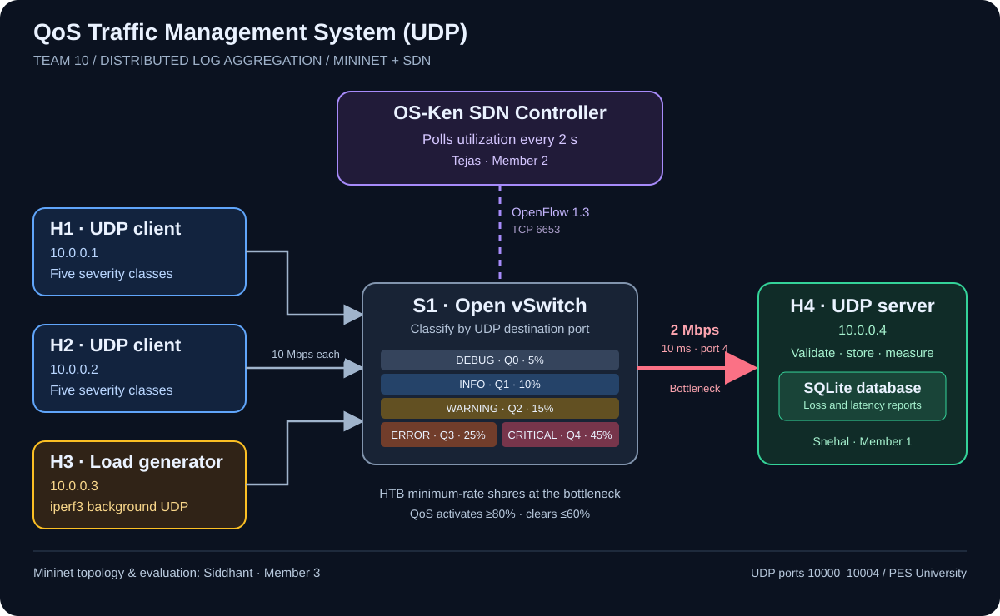

# Team 10 — QoS Traffic Management System (UDP)

**Distributed Log Aggregation System (UDP + SDN)** · Computer Networks · PES University

This project uses Python UDP sockets, Mininet, Open vSwitch (OVS), and an OS-Ken software-defined networking controller to collect application logs and dynamically differentiate network service during congestion.

## Team and completed components

| Member | Name | Component |
|---|---|---|
| 1 | SNEHAL AGRAWAL | [UDP application](member1_udp_application/): traffic generation, validation, SQLite collection, statistics and automated tests |
| 2 | TEJAS DIWAKAR | [SDN controller](member2_sdn_controller/): OpenFlow 1.3 forwarding, congestion monitoring and QoS queue selection |
| 3 | SIDDHANT CHAWLA | [Mininet and evaluation](member3_mininet_testing/): topology, bottleneck, congestion tests, integration and performance analysis |

All three components have been implemented and integrated, as documented in the [final integration report](docs/integration/FINAL_INTEGRATION_REPORT.md).

## Architecture



H1 and H2 generate log traffic; H3 generates UDP background load to congest the bottleneck to H4. The controller polls the bottleneck every 2 seconds, enters severity-priority mode at utilization >= 80%, and returns to baseline forwarding at <= 60%. Between these thresholds it retains the current policy.

## Traffic classification and QoS

| Severity | UDP destination port | OVS queue | HTB minimum-rate share |
|---|---:|---:|---:|
| DEBUG | 10000 | 0 | 5% |
| INFO | 10001 | 1 | 10% |
| WARNING | 10002 | 2 | 15% |
| ERROR | 10003 | 3 | 25% |
| CRITICAL | 10004 | 4 | 45% |

The controller classifies by UDP destination port (not JSON contents). OpenFlow rule priority is match precedence; Linux HTB queues provide the configured service differentiation. Queue IDs and shares are not strict-priority guarantees.

## Quick start — application only

Python 3.10+; standard library only. From the repository root:

```bash
cd member1_udp_application
python3 -m unittest discover -s tests -v
python3 -m scripts.run_local_demo
python3 -m app.query_logs --db demo_output/logs.db --stats
python3 -m app.query_logs --db demo_output/logs.db --severity CRITICAL
```

The recorded local demo used ports 18000–18004 and stored 25/25 logs; new runs choose available ports automatically. The integrated system uses ports 10000–10004.

## Full system

Use a Linux/Ubuntu lab environment with Mininet, OVS, iperf3, Python 3.11 and the controller dependency pinned in [requirements.txt](member2_sdn_controller/requirements.txt) (OS-Ken 3.1.1). Python scripts do not require compilation or a Makefile.

Follow the [end-to-end integration guide](docs/INTEGRATION.md) to start the controller, topology, queue configuration, UDP clients and collector, and run controlled background traffic.

## Recorded results

| Experiment | H1 + H2 logs received / sent | Background UDP receiver throughput | Background UDP loss |
|---|---:|---:|---:|
| Light (0.5 Mbps offered) | 600/600 | 0.50 Mbps | 0% |
| Medium (1.5 Mbps offered) | 600/600 | 1.50 Mbps | 0% |
| Heavy (3 Mbps offered) | 343/600 | 1.94 Mbps | 35% |

These are the committed baseline experiment results in [results/](member3_mininet_testing/results/). The separate final integration report records 50 stored logs (10 per severity), approximately 12 ms mean one-way delay per severity, congestion activation at approximately 100% utilization, and verified queue mappings. These results demonstrate integration; they are not a matched quantitative QoS-versus-FIFO comparison.

## Documentation and evidence

- [Software Requirements Specification (SRS)](docs/SRS.md)
- [Software Test Plan (STP)](docs/STP.md)

- [Integration guide and protocol contract](docs/INTEGRATION.md)
- [Final integration report, evaluation and fairness calculations](docs/integration/FINAL_INTEGRATION_REPORT.md)
- [Application test evidence](member1_udp_application/samples/verified_demo/)
- [Controller setup and verification](member2_sdn_controller/README.md)
- [Baseline performance results and graphs](member3_mininet_testing/results/)

Do not commit generated databases, caches, credentials, or temporary output. Preserve representative experiment evidence and label test conditions.
