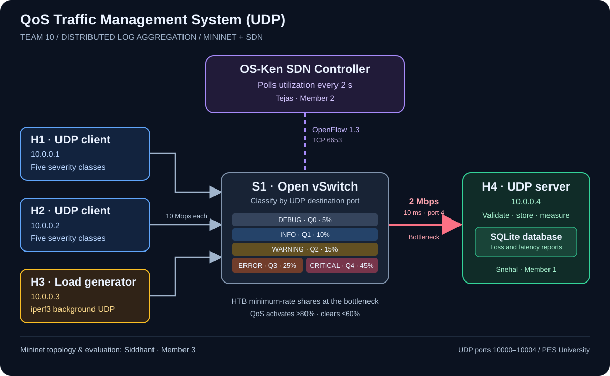

# Software Requirements Specification (SRS)

**QoS Traffic Management System (UDP) — Distributed UDP Log Aggregation System**

SRS-QOS-001 | Version 1.1 (repository edition) | PES University, Computer Networks

Team 10: SNEHAL AGRAWAL, TEJAS DIWAKAR, SIDDHANT CHAWLA

17 November 2026; repository edition aligned with the cleaned submission.

## Revision history

| Version | Date | Changes |
| --- | --- | --- |
| 1.0 | November 2026 | Initial integrated project SRS |
| 1.1 | 17 November 2026 | Named authors; verified current source and integration evidence |
| 1.1 repository edition | 19 November 2026 | GitHub-readable adaptation; current documentation links and architecture |

## 1. Introduction

### 1.1 Purpose
This SRS specifies application, SDN control, network emulation and measurement requirements for the integrated QoS Traffic Management System (UDP), implemented as distributed log aggregation.

### 1.2 Document conventions
FR means functional requirement; NFR means nonfunctional requirement. Requirements have High or Medium priority; “shall” denotes a required behavior. Expected QoS improvements are acceptance objectives, not a guarantee of UDP delivery.

### 1.3 Intended audience and reading suggestions
Course instructors, evaluators, developers and testers. Section 2 describes the system; Section 3 defines interfaces; Section 4 specifies functional behavior; Section 5 defines quality and evaluation requirements. The [companion STP](STP.md) maps requirements to test cases.

### 1.4 Product scope
UDP applications can lose datagrams and experience increasing delay under congestion. Five application log severity classes represent differentiated traffic. A central collector stores logs. An SDN controller monitors a constrained link and selects per-class OVS queues when utilization rises, restoring baseline forwarding when load falls.

- Generate and classify application UDP traffic; use independent sequence numbers and timestamps.
- Create controlled background load in Mininet and prioritize important logs using OVS queues.
- Measure delivery, loss, latency, jitter and throughput; evaluate fairness and compare baseline versus QoS.

### 1.5 References
- Team 10 project problem statement: QoS Traffic Management System (UDP).
- Karl E. Wiegers SRS template (1999); IEEE Std 830-1998 (reference format).
- RFC 768 (UDP); OpenFlow Switch Specification 1.3; Mininet, OVS and OS-Ken documentation.
- [Integration guide](INTEGRATION.md) and [final integration report](integration/FINAL_INTEGRATION_REPORT.md).

## 2. Overall description

### 2.1 Product perspective
Three integrated modules: UDP application (Snehal Agrawal), OS-Ken SDN controller (Tejas Diwakar), and Mininet/performance analysis (Siddhant Chawla). H1/H2 send logs; H3 supplies background load; H4 hosts the collector. The system is a standalone teaching system; see Appendix B.

### 2.2 Product functions
- Send five severity classes, validate datagrams and persist unique records.
- Learn forwarding paths, classify UDP destination ports and select HTB queues under congestion.
- Poll bottleneck utilization; activate and clear QoS; run load experiments and export statistics.

### 2.3 User classes and characteristics
Student operators configure the VM, launch scripts and inspect logs. Evaluators review the demonstration, flow rules, queues and metrics. Developers maintain their module and shared interfaces.

### 2.4 Operating environment
Linux/Ubuntu VM; Mininet and Open vSwitch; Python 3.10+ application, Python 3.11 controller environment, OS-Ken 3.1.1, OpenFlow 1.3, iperf3, SQLite and Matplotlib.

### 2.5 Design and implementation constraints
C-1: UDP sockets; no retransmission guarantee. C-2: OpenFlow 1.3 and Linux HTB queues. C-3: five fixed destination ports by default. C-4: congestion tests confined to the emulated network.

### 2.6 User documentation
[Project README](../README.md), member READMEs, [integration guide](INTEGRATION.md), [final integration report](integration/FINAL_INTEGRATION_REPORT.md), this SRS and [STP](STP.md).

### 2.7 Assumptions and dependencies
DPID 1 and port 4 must match the topology. Mininet hosts share a clock for one-way delay. Sender and receiver records are session-isolated; the controller must reach S1.

## 3. External interface requirements

### 3.1 User interfaces
CLI only: python3 -m app.client, app.server, app.query_logs, app.compare_results, Mininet CLI, controller run script and ovs-vsctl / ovs-ofctl verification. Terminal logs and CSV/PNG outputs provide feedback.

### 3.2 Hardware interfaces
No dedicated hardware required. A Linux test environment hosts virtual hosts, links and the OVS switch. CPU and memory must support the VM and concurrent processes.

### 3.3 Software interfaces

| Interface | Contract |
| --- | --- |
| Controller ↔ OVS | OpenFlow 1.3 over TCP 6653; port/flow stats, FlowMod, PacketIn/PacketOut |
| Controller ↔ QoS | Linux HTB queues on s1-eth4; SetQueue then Output |
| Application ↔ database | SQLite logs table; unique host/session/severity/sequence key |
| Analysis ↔ evidence | Sender-summary JSON, SQLite rows, iperf3 receiver summaries, CSV and PNG |

### 3.4 Communications interfaces
One UTF-8 JSON record per UDP datagram (max 1,200 bytes; 1–700 message characters). Default ALL mode sends a packet every 100 ms, cycling classes (~2 packets/s/class). Count, interval and message size are configurable.

| Field | Meaning |
| --- | --- |
| version | Protocol version 1 |
| host_id | Client identifier (1–64 allowed characters) |
| session_id | Canonical UUID for each run |
| severity | One of five classes |
| sequence | Positive integer, per host/session/severity |
| sent_ns | Unix send timestamp in nanoseconds |
| message | Application log text |

| Severity | UDP destination port | Queue | HTB minimum share |
| --- | --- | --- | --- |
| DEBUG | 10000 | 0 | 5% / 100 kbps |
| INFO | 10001 | 1 | 10% / 200 kbps |
| WARNING | 10002 | 2 | 15% / 300 kbps |
| ERROR | 10003 | 3 | 25% / 500 kbps |
| CRITICAL | 10004 | 4 | 45% / 900 kbps |

These are configured minimum rates at 2 Mbps, not measured throughput or strict-priority guarantees. Payload size varies with JSON fields; separate client runs can use distinct sizes and rates.

## 4. System features

All six features have High priority.

### 4.1 UDP traffic generation (Member 1)
**Description:** Generate independently configurable severity-tagged log traffic. **Stimulus/response:** operator starts sender → encode and send to the matching port.

- FR-1: Generate all five severity classes or a selected class; support configurable count, interval and message size.
- FR-2: Encode the seven protocol fields, per-severity sequence and per-run UUID; route by severity port.
- FR-3: Save successful send counts by severity and session; report local socket errors without claiming remote delivery.

### 4.2 UDP reception and storage (Member 1)
**Description:** Collect logs from multiple hosts and maintain valid unique records. **Stimulus/response:** datagram arrives → validate → track sequence → store or reject.

- FR-4: Listen concurrently on five UDP ports and accept multiple clients.
- FR-5: Reject malformed, oversized or severity-mismatched datagrams; detect duplicates and out-of-order arrivals.
- FR-6: Persist unique valid logs with source, timestamps and delay; allow filtering by host, severity and session.

### 4.3 Network topology and congestion generation (Member 3)
**Description:** Provide a repeatable isolated bottleneck. **Stimulus/response:** Mininet starts → hosts connect → background load is offered.

- FR-7: Create H1–H4 and S1; provide 10 Mbps sender links and a 2 Mbps S1–H4 link with 10 ms delay and queue limit 50 in topology.
- FR-8: Allow concurrent H1/H2 logs and H3 iperf3 UDP background traffic under controlled loads.

### 4.4 Classification and QoS queues (Member 2)
**Description:** Differentiate log traffic by destination port. **Stimulus/response:** packet reaches S1 → controller learns forwarding → selects queue when congested.

- FR-9: Use OpenFlow 1.3 forwarding and IPv4/UDP destination-port matches for the five classes.
- FR-10: Configure Linux HTB QoS on bottleneck egress with queues 0–4 and the minimum rates in Section 3.4.
- FR-11: While congested, apply matching SetQueue action before output on DPID 1, port 4; otherwise use baseline forwarding.

### 4.5 Dynamic congestion policy (Member 2)
**Description:** Adjust forwarding behavior based on measured load. **Stimulus/response:** port counter samples → utilization threshold crossed → dynamic rules deleted and relearned.

- FR-12: Poll bottleneck transmit counters every 2 seconds and estimate utilization from byte-rate and configured capacity.
- FR-13: Enter severity-priority mode at ≥80% utilization; restore baseline at ≤60%; retain state between thresholds.
- FR-14: Log utilization and policy transitions; invalidate cookie-1 learned flows and relearn on subsequent packets. Preserve the table-miss rule.

### 4.6 Performance analysis (Members 1 and 3)
**Description:** Measure and compare system behavior. **Stimulus/response:** trial ends → match sender summaries to receiver rows → export metrics.

- FR-15: Calculate unique received, lost, loss percentage and one-way delay per severity, including missing trailing packets.
- FR-16: Measure background UDP throughput, jitter and loss; export application per-class loss/latency and iperf3 metrics/graphs.
- FR-17: Evaluate per-class throughput, jitter, fairness, loss and latency in matched no-QoS (FIFO) and QoS trials at no/light, moderate and heavy load.

## 5. Other nonfunctional requirements

### 5.1 Performance requirements
- NFR-1: Under the uncongested local demonstration, all 25 valid logs shall be stored once (0% loss).
- NFR-2: The controller shall use the 2-second sampling interval and 80%/60% hysteresis thresholds.
- NFR-3: In matched congested trials, evaluate high-priority classes for reduced loss and/or latency relative to FIFO; report the outcome without assuming guaranteed delivery.
- NFR-4: Reports shall state units, offered load, policy and clock assumptions; compare trials with equivalent conditions.

### 5.2 Safety requirements
All intentional congestion shall remain within isolated Mininet. Queue setup shall target the confirmed bottleneck and require explicit confirmation.

### 5.3 Security requirements
Validate payload structure and use parameterized database queries. Authentication, encryption and Internet-facing deployment are outside scope.

### 5.4 Software quality attributes
- Reliability: malformed messages and duplicates shall not corrupt persisted records; UDP may still lose packets.
- Maintainability: application, controller and test modules remain identifiable.
- Testability: map requirements to test cases with reproducible scripts and observed evidence.
- Portability: standard-library Python application; Linux/OVS network testing.

### 5.5 Business rules
CRITICAL and ERROR have the highest configured minimum rates. Classification uses destination ports, not JSON inspection. Baseline actions omit SetQueue; a true FIFO control must also remove HTB differentiation.

## 6. Other requirements
Document setup, topology, queue and flow configuration, experiments, measurements, live demonstration and limitations. No retransmission or guaranteed delivery is assumed.

## Appendix A: Glossary

| Term | Meaning |
| --- | --- |
| UDP | User Datagram Protocol; connectionless transport without delivery or ordering guarantees |
| SDN | Software-defined networking; centralized forwarding control |
| QoS | Quality of Service; differentiation of network traffic service |
| OVS / HTB | Open vSwitch / Hierarchical Token Bucket traffic scheduling |
| OpenFlow | Controller-switch communication protocol |
| OS-Ken | Python SDN controller framework derived from Ryu |
| Mininet | Virtual host/link network emulator |
| Jitter | Variation in packet arrival timing/delay |
| Jain's index | (sum x)² / (n × sum x²), for nonnegative rates or delivery ratios |

## Appendix B: Analysis models

### B.1 Architecture

### B.2 Flow of a UDP log

| Step | Component | Action |
| --- | --- | --- |
| 1 | H1/H2 | Generate JSON records and send to severity destination ports |
| 2 | Switch/controller | Forward packets; apply severity queue selection when congested |
| 3 | H4 | Validate datagrams, track sequences, store unique records in SQLite |
| 4 | Analysis | Match summaries to rows, export loss and delay |

### B.3 Congestion and recovery

| Step | Component | Action |
| --- | --- | --- |
| 1 | H3 | Generate controlled background UDP traffic |
| 2 | Controller | Poll egress counters every 2 s; enter QoS at ≥80% |
| 3 | Switch | Apply queue selection; retain state between thresholds |
| 4 | Controller | Clear at ≤60%; invalidate learned rules and return to baseline |

### B.4 Performance calculations
Loss (%) = 100 × (sent − unique received) / sent. Delay (ms) = (receive_ns − sent_ns) / 1,000,000. Throughput = delivered bits / trial seconds. Jitter measures delay variation. Fairness uses a consistent class delivery ratio or rate.

## Appendix C: To be determined list
Integrated implementation is recorded as complete. The final report confirms congestion entry and queue mapping and describes the recovery policy. Saved experiments are baseline; matched QoS measurements, per-class throughput/jitter and raw recovery traces are not archived. Evidence is detailed in the [final integration report](integration/FINAL_INTEGRATION_REPORT.md) and [STP](STP.md).
